# [Drone] Point-to-Point (Regulation) Control of NPS II Drone Based on SDRE (Matlab Code Implementation)

​  
Geranmehr, Behdad, and Saeed Rafee Nekoo. "Nonlinear suboptimal control of fully coupled non-affine six-DOF autonomous underwater vehicle using the state-dependent Riccati equation." Ocean Engineering 96 (2015): 248-257.📚2 Run results
Editor
Editor
Editor
Editor
Editor
Editor
Editor
Editor
Editor
Editor
Editor
Editor
Part of the code:
UB=20*pi/180;  
xin1=6;            %x  
xin2=4;            %y  
xin3=-5;            %z  
xin4=0.2;           %phi  
xin5=-0.15;          %theta  
xin6=0.25;           %psi  
xin7=0;            %u  
xin8=0;            %v  
xin9=0;            %w  
xin10=0;            %p  
xin11=0;            %q  
xin12=0;            %r  
xin13=0;            %delta_r  
xin14=0;            %delta_s  
xin15=0;            %delta_b  
xin16=0;            %delta_bp  
xin17=0;            %delta_bs  
xin18=100;           %n  
xdes1=0;  
xdes2=0;  
xdes3=0;  
xdes4=0;  
xdes5=0;  
xdes6=0;  
xdes7=0;  
xdes8=0;  
xdes9=0;  
xdes10=0;  
xdes11=0;  
xdes12=0;  
L=5.3;             %The length of the AUV (m)  
g=9.81;            % (m/s^2)  
rho=1000;           %density of water (kg/m^3)  
m=5454.54;           %The mass of the AUV (kg)  
W=53400;            %weight (N)  
Buoy=53400;          %buoyancy (N)  
Ix=2038;Iy=13587;Iz=13587;           % (Nms^2)  
Ixy=-13.58;Iyz=-13.58;Ixz=-13.58;       % (Nms^2)  
xG=0;yG=0;zG=0.061;  
xB=0;yB=0;zB=0;  
I_O=[Ix,-Ixy,-Ixz;...  
-Ixy,Iy,Iyz;...  
-Ixz,-Iyz,Iz];  
r_G=[xG;yG;zG];  
r_B=[xB;yB;zB];  
%Non-Dimensional Hydrodynamic coefficients---------------------------------  
Xudot=-7.6e-3;Xwq=-2.0e-1;Xvp=-3.0e-3;Xvr=2.0e-2;  
Xqds=2.5e-2;Xqdb2=-1.3e-3;Xrdr=-1.0e-3;Xvv=5.3e-2;  
Xww=1.7e-1;Xvdr=1.7e-3;Xwds=4.6e-2;Xwdb2=0.5e-2;  
Xdsds=-1.0e-2;Xdbdb2=-4.0e-3;Xdrdr=-1.0e-2;Xqdsn=2.0e-3;  
Xwdsn=3.5e-3;Xdsdsn=-1.6e-3;Xu=0;  
Ypdot=1.2e-4;Yrdot=1.2e-3;Ypq=4.0e-3;Yqr=-6.5e-3;  
Yvdot=-5.5e-2;Yp=3.0e-3;Yr=3.0e-2;Yvq=2.4e-2;  
Ywp=2.3e-1;Ywr=-1.9e-2;Yv=-1.0e-1;Yvw=6.8e-2;  
Ydr=2.7e-2;  
Zqdot=-6.8e-3;Zpp=1.3e-4;Zpr=6.7e-3;Zrr=-7.4e-3;  
Zwdot=-2.4e-1;Zq=-1.4e-1;Zvp=-4.8e-2;Zvr=4.5e-2;  
Zw=-3.0e-1;Zvv=-6.8e-2;Zds=-7.3e-2;Zdb2=-1.3e-2;  
Zqn=-2.9e-3;Zwn=-5.1e-3;Zdsn=-1.0e-2;  
Kpdot=-1.0e-3;Krdot=-3.4e-5;Kpq=-6.9e-5;Kqr=1.7e-2;  
Kvdot=1.2e-4;Kp=-1.1e-2;Kr=-8.4e-4;Kvq=-5.1e-3;  
Kwp=-1.3e-4;Kwr=1.4e-2;Kv=3.1e-3;Kvw=-1.9e-1;  
Kdb2=0;Kpn=-5.7e-4;Kprop=0;  
Mqdot=-1.7e-2;Mpp=5.3e-5;Mpr=5.0e-3;Mrr=2.9e-3;  
Mwdot=-6.8e-3;Muq=-6.8e-2;Mvp=1.2e-3;Mvr=1.7e-2;  
Muw=1.0e-1;Mvv=-2.6e-2;Mds=-4.1e-2;Mdb2=3.5e-3;  
Mqn=-1.6e-3;Mwn=-2.9e-3;Mdsn=-5.2e-3;Mq=-0.068;  
Npdot=-3.4e-5;Nrdot=-3.4e-3;Npq=-2.1e-2;Nqr=2.7e-3;  
Nvdot=1.2e-3;Np=-8.4e-4;Nr=-1.6e-2;Nvq=-1.0e-2;  
Nwp=-1.7e-2;Nwr=7.4e-3;Nv=-7.4e-3;Nvw=-2.7e-2;  
Ndr=-1.3e-2;Nprop=0;  
%Dimensional Coefficients--------------------------------------------------  
% Xu_au=0;  
% Yv_av=2.065e-4;  
% Zw_aw=3.381e-4;  
% Kp_ap=0;  
% Mq_aq=0.295e-3;  
% Nr_ar=0.231e-3;  
Xu_au=-30.9;  
Yv_av=-206.5;  
Zw_aw=-338.1;  
Kp_ap=0;  
Mq_aq=-214.66;  
Nr_ar=-346.26;  
%Main----------------------------------------------------------------------  
[t,n]=ode45('sdre_6DOF_Fullstates',0:tf/N:tf,[xin1,xin2,xin3,xin4,xin5,xin6,...  
xin7,xin8,xin9,xin10,xin11,xin12,xin13,xin14,xin15,xin16,xin17,xin18]');  
save matlab  
n1=n(:,1);  
n2=n(:,2);  
n3=n(:,3);  
n4=n(:,4);  
n5=n(:,5);  
n6=n(:,6);  
n7=n(:,7);  
n8=n(:,8);  
n9=n(:,9);  
n10=n(:,10);  
n11=n(:,11);  
n12=n(:,12);  
%Plots---------------------------------------------------------------------  
figure(1)  
axes1=axes('Parent',figure(1),'FontSize',10,'FontName','Cambria');  
box(axes1,'on');  
hold(axes1,'all');  
plot(t,n1,'k','linewidth',2)  
plot(t,n2,':b','linewidth',2)  
plot(t,n3,'--r','linewidth',2)  
xlabel('t (s)','FontSize',10,'FontName','Cambria');  
ylabel('Position (m)','FontSize',10,'FontName','Cambria');  
box on  
grid on  
🎉3 References
🌈4 Matlab code implementation

## Images

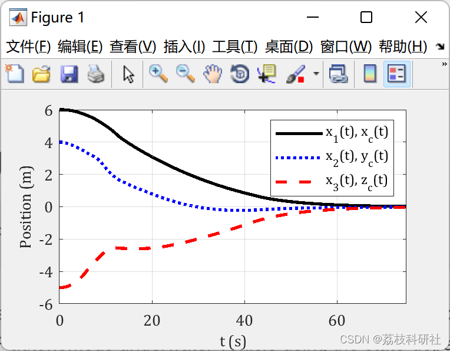
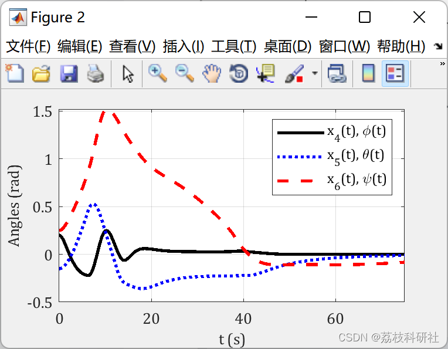
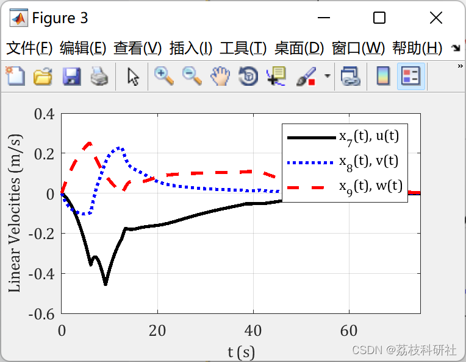
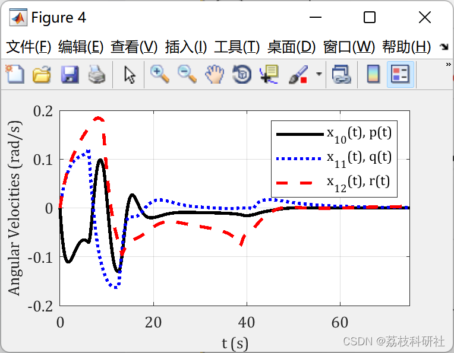
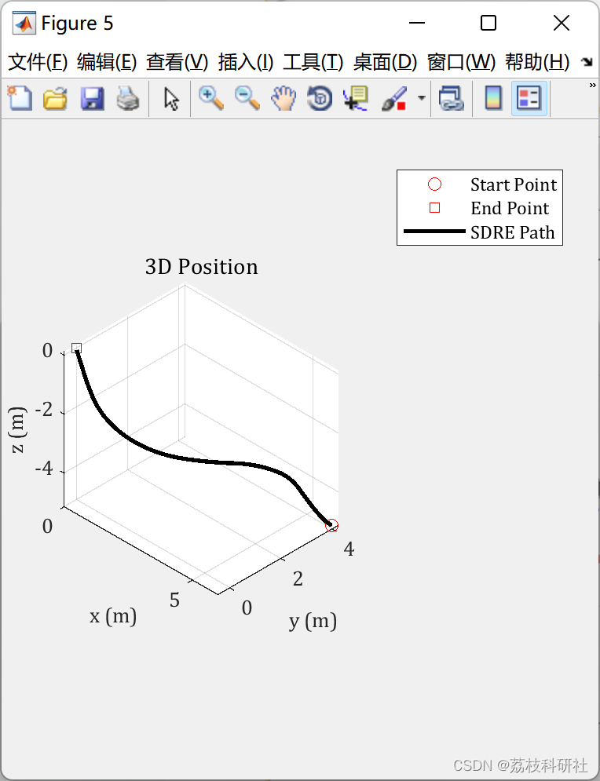
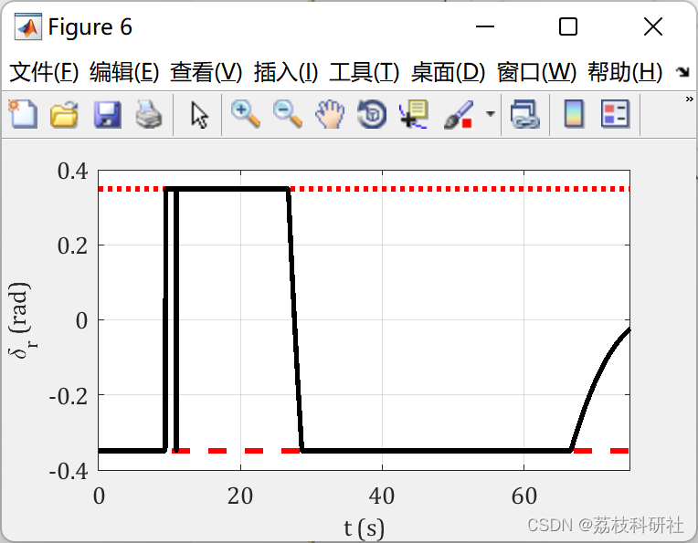
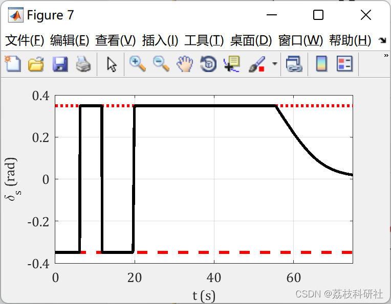
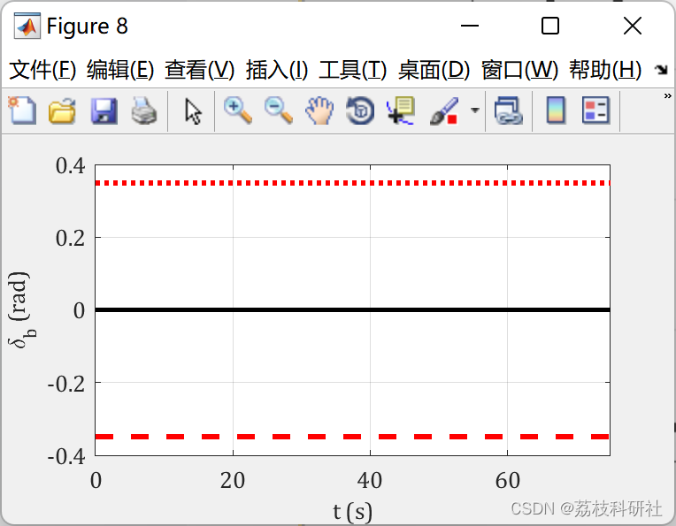

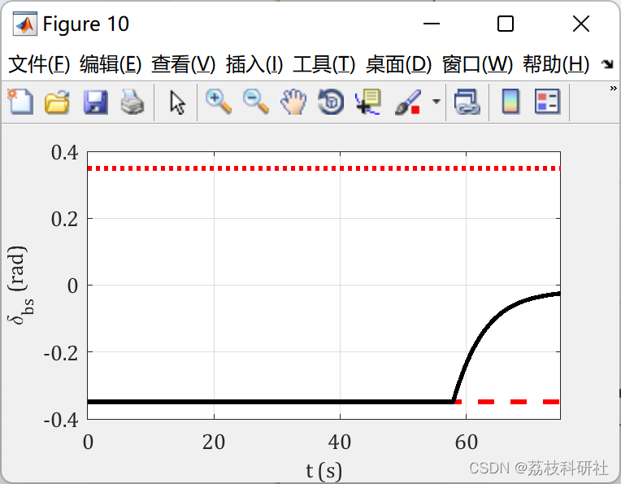
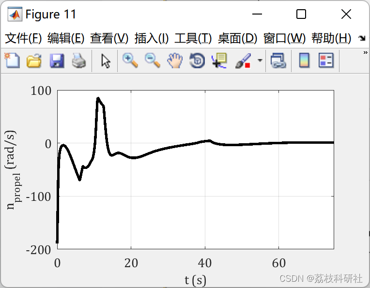
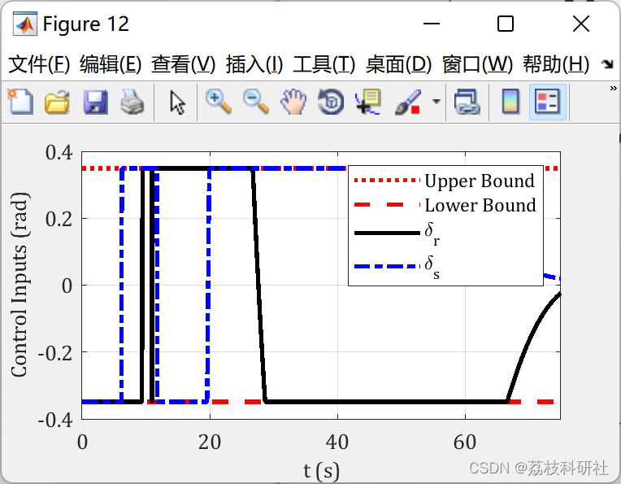
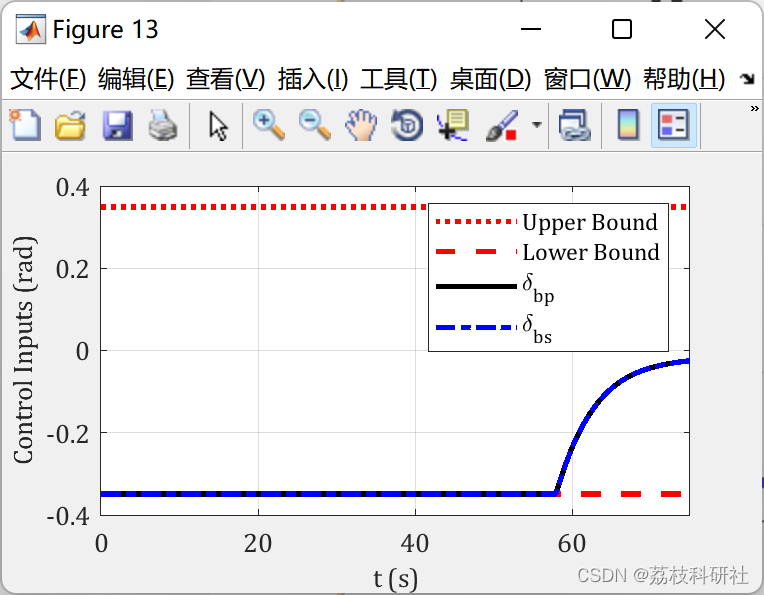

<!-- PAYMENT_BLOCK -->

## Get this dataset

- Payment link (Stripe): [Buy now](https://buy.stripe.com/3cs8yP7sY87d0vu9AB)
- Payment QR code: 

<!-- /PAYMENT_BLOCK -->
